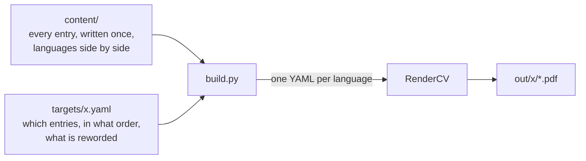
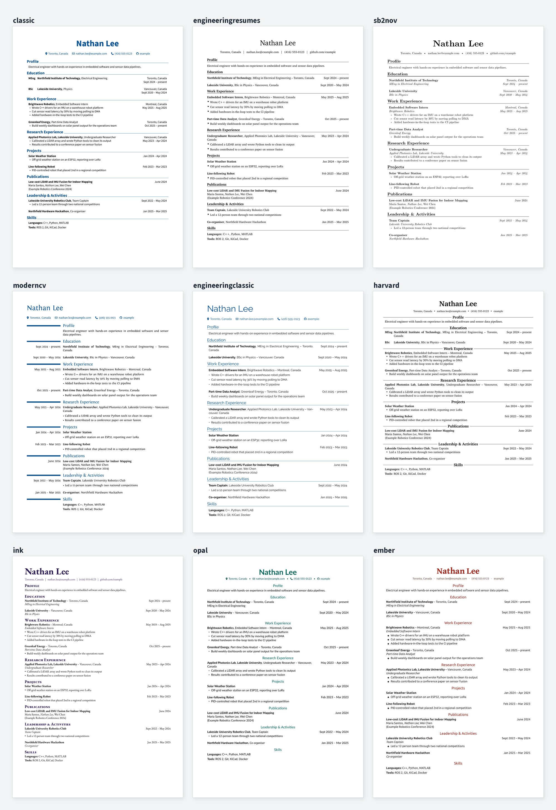

<!-- markdownlint-disable MD033 MD041 -->

<div align="center">

<h1>Prism CV</h1>

<p><strong>One source, every CV.</strong></p>

<p>
  <a href="LICENSE"></a>
  
  <a href="https://github.com/rendercv/rendercv"></a>
  <a href="README.zh-CN.md"></a>
</p>

</div>

Keep your whole career in one place and build every version of your CV from it: each language, academic and industry, and one tailored to each job. Edit an entry once and every version picks it up.

## How it works



[RenderCV](https://github.com/rendercv/rendercv) typesets one YAML file into a PDF. Prism CV assembles that file from your content and a target; all layout is RenderCV's.

## Quick start

Requires Python 3.12+. The Chinese example also needs [Noto Sans SC](https://fonts.google.com/noto/specimen/Noto+Sans+SC).

```sh
pip install -r requirements.txt
python build.py --all                 # every target
python build.py industry --lang en    # one target, one language
python build.py industry --debug      # keep the generated RenderCV input
```

PDFs go to `out/<target>/`. The repository ships with a fictional example; replace `content/` with your own.

## Themes

Set `theme` in `design.yaml`.



## Content

`content/header.yaml` holds your name and contact details, `content/sections.yaml` the section titles, and every other file holds entries keyed by an id. Fields use [RenderCV's names](https://docs.rendercv.com).

Text that differs between languages maps language codes to text; anything else is written once. An excerpt from [`content/experience.yaml`](content/experience.yaml):

```yaml
brightwave-intern:
  company: { en: Brightwave Robotics, zh: 明波机器人 }
  location: { en: "Montreal, Canada", zh: 蒙特利尔 }
  start_date: 2025-05
  end_date: present
  highlights:
    - en: Wrote C++ drivers for an IMU
      zh: 编写惯性测量单元的 C++ 驱动
```

Use `zh: null` to leave a bullet out of one language. An id can also hold a list of entries (a group of skills), and an entry with only `text` is a paragraph (a profile).

## Targets

Each file in `targets/` is one version of the CV. `langs` defaults to every language, and `max_pages` warns when a PDF is longer. An excerpt from [a target tailored to one job](targets/jobs/2026-10-15_example-data-engineer.yaml):

```yaml
langs: [en]
max_pages: 1
sections:
  profile:
    - text: Engineer who enjoys turning messy sensor data into reliable pipelines.
  work:
    title: Experience
    entries:
      - brightwave-intern@data
      - greenleaf-analyst:
          highlights:
            - Rewritten bullet for this role only
```

An item is an id, an id with fields to override, or an entry written inline. A variant such as `brightwave-intern@data` lives in `content/` and changes only the fields it lists, so it suits rewording you will reuse. `title` renames a section for this target.

## Languages

`languages` in `design.yaml` maps each code to a [RenderCV locale](https://docs.rendercv.com). To add one, add it there, put any settings it needs under its code (a font, a date format), and add its text to the content you use; the build lists anything missing.

## License

```text
MIT License

Copyright (c) 2026 Andy Zhang

Permission is hereby granted, free of charge, to any person obtaining a copy
of this software and associated documentation files (the "Software"), to deal
in the Software without restriction, including without limitation the rights
to use, copy, modify, merge, publish, distribute, sublicense, and/or sell
copies of the Software, and to permit persons to whom the Software is
furnished to do so, subject to the following conditions:

The above copyright notice and this permission notice shall be included in all
copies or substantial portions of the Software.

THE SOFTWARE IS PROVIDED "AS IS", WITHOUT WARRANTY OF ANY KIND, EXPRESS OR
IMPLIED, INCLUDING BUT NOT LIMITED TO THE WARRANTIES OF MERCHANTABILITY,
FITNESS FOR A PARTICULAR PURPOSE AND NONINFRINGEMENT. IN NO EVENT SHALL THE
AUTHORS OR COPYRIGHT HOLDERS BE LIABLE FOR ANY CLAIM, DAMAGES OR OTHER
LIABILITY, WHETHER IN AN ACTION OF CONTRACT, TORT OR OTHERWISE, ARISING FROM,
OUT OF OR IN CONNECTION WITH THE SOFTWARE OR THE USE OR OTHER DEALINGS IN THE
SOFTWARE.
```
