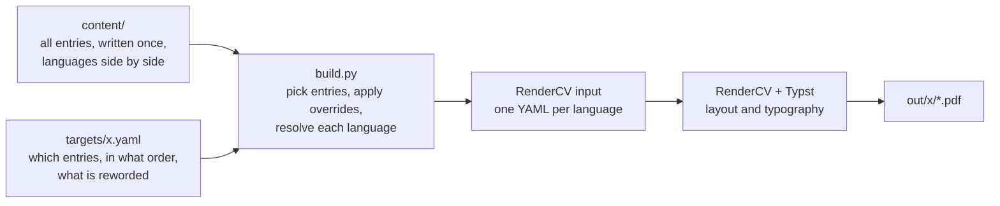

<!-- markdownlint-disable MD033 MD041 -->

<div align="center">

<h1>Prism CV</h1>

<p><strong>One source, every CV.</strong></p>

<p>
  <a href="LICENSE"></a>
  
  <a href="https://github.com/rendercv/rendercv"></a>
  <a href="README.zh-CN.md"></a>
</p>

</div>

Keep your whole career in one place and build every version of your CV from it: each language, academic and industry, and one tailored to each job.

## Why

Once you have a CV in two languages, an academic and an industry version, and a few copies tailored to specific jobs, the same experience lives in many files. Change one bullet and you have to find every copy. Sooner or later they drift apart.

Prism CV keeps each piece of content in exactly one place. A version of your CV is just a short list of what to include, so changing an entry updates every version the next time you build.

## How it works



[RenderCV](https://github.com/rendercv/rendercv) turns a single YAML file into a well-typeset PDF, but it reads only one file per CV, and the content of that file cannot be split up or shared. Prism CV is a thin layer in front of it: `build.py` assembles that file from your content and a target, then hands it to RenderCV. All layout and typography is RenderCV's.

## Quick start

Requires Python 3.12 or later.

```sh
pip install -r requirements.txt
python build.py --all
```

PDFs appear in `out/<target>/`. The repository ships with a fictional example CV so you can see the result straight away; replace the files in `content/` with your own.

The Chinese example uses [Noto Sans SC](https://fonts.google.com/noto/specimen/Noto+Sans+SC). Install the files in its `static/` folder; skip the variable font, which Typst does not fully support.

```sh
python build.py industry                               # one target
python build.py jobs/2026-10-15_example-data-engineer  # a target in a subfolder
python build.py industry --lang en                     # one language only
python build.py industry --debug                       # keep the RenderCV input for inspection
```

## Themes

The example CV in each of RenderCV's built-in themes. Switch with `theme` in `design.yaml`.


The Chinese settings in `design.yaml` are tuned for `classic`; other themes may need their own entry templates.

## Layout

```text
content/
  header.yaml     name and contact details
  sections.yaml   section titles
  *.yaml          entries, split into files however you like
targets/          one file per version of the CV
  jobs/           versions tailored to a job, named date_company_role.yaml
design.yaml       languages, theme, fonts and date formats
```

## Writing content

Every entry has an id that is unique across `content/`. Fields use RenderCV's names (see the [RenderCV docs](https://docs.rendercv.com)).

Text that is the same in every language is written once. Text that differs is a mapping from language code to text:

```yaml
brightwave-intern:
  company: { en: Brightwave Robotics, zh: 明波机器人 }
  position: { en: Embedded Software Intern, zh: 嵌入式软件实习生 }
  location: { en: "Montreal, Canada", zh: 蒙特利尔 }
  start_date: 2025-05
  end_date: present
  highlights:
    - en: Wrote C++ drivers for an IMU
      zh: 编写惯性测量单元的 C++ 驱动
```

- Put text that contains a comma in quotes, as in `"Montreal, Canada"`.
- Leave a bullet out of one language with `zh: null`.
- If the languages need different numbers of bullets, write `highlights: { en: [...], zh: [...] }`.
- An id can hold a list of entries, such as a group of skills.
- An entry with only a `text` field is a plain paragraph, used for profiles.

## Writing targets

```yaml
langs: [en, zh]
max_pages: 1
sections:
  profile: [profile-industry]
  education: [meng, bsc]
  work: [brightwave-intern, greenleaf-analyst]
```

Sections appear in the order written. Each key needs a title in `content/sections.yaml`. `langs` defaults to every configured language; leave out `max_pages` for no limit.

## Tailoring

```yaml
sections:
  profile:
    - text: A paragraph written for this job only.
  work:
    title: Experience
    entries:
      - brightwave-intern@data
      - greenleaf-analyst:
          highlights:
            - A bullet reworded for this job
```

- **Inline entry**: write the entry directly in the target.
- **Override**: `id: {fields}` replaces those fields and keeps the rest.
- **Variant**: an id such as `brightwave-intern@data` in `content/` inherits every field from `brightwave-intern` and replaces only the ones it lists (`base: <id>` names a different parent).
- **Title**: `title:` renames a section for one target.

Rewording used once belongs in the target; rewording you will reuse belongs in a variant. If the dates or organisation change, it is a different entry, not a variant.

## Languages

English and Chinese are configured as an example; any language works. To add one:

1. Add its code to `languages` in `design.yaml`.
2. In `design.yaml`, give that code a value wherever the existing languages have one: font, date format, entry templates and `locale.language` (one of the languages RenderCV supports).
3. Add text in the new language to the content its targets use. The build tells you exactly which fields are missing.

The first language in the list names the PDF files.

## Checks

`build.py` stops with the file and position when an id is duplicated or unknown, text is missing for a language, a section mixes entry types or has no title, or `max_pages` is not a positive number. It warns when a PDF is longer than `max_pages`. Dates and field formats are validated by RenderCV.

## Notes

- RenderCV is pinned in `requirements.txt`; its YAML format has changed between major versions.
- A bullet containing ` - ` is read by RenderCV as a nested list.
- A target refers to content, so rebuilding it after editing `content/` gives the new wording. Keep a copy of every PDF you send.

## License

```text
MIT License

Copyright (c) 2026 Andy Zhang

Permission is hereby granted, free of charge, to any person obtaining a copy
of this software and associated documentation files (the "Software"), to deal
in the Software without restriction, including without limitation the rights
to use, copy, modify, merge, publish, distribute, sublicense, and/or sell
copies of the Software, and to permit persons to whom the Software is
furnished to do so, subject to the following conditions:

The above copyright notice and this permission notice shall be included in all
copies or substantial portions of the Software.

THE SOFTWARE IS PROVIDED "AS IS", WITHOUT WARRANTY OF ANY KIND, EXPRESS OR
IMPLIED, INCLUDING BUT NOT LIMITED TO THE WARRANTIES OF MERCHANTABILITY,
FITNESS FOR A PARTICULAR PURPOSE AND NONINFRINGEMENT. IN NO EVENT SHALL THE
AUTHORS OR COPYRIGHT HOLDERS BE LIABLE FOR ANY CLAIM, DAMAGES OR OTHER
LIABILITY, WHETHER IN AN ACTION OF CONTRACT, TORT OR OTHERWISE, ARISING FROM,
OUT OF OR IN CONNECTION WITH THE SOFTWARE OR THE USE OR OTHER DEALINGS IN THE
SOFTWARE.
```
