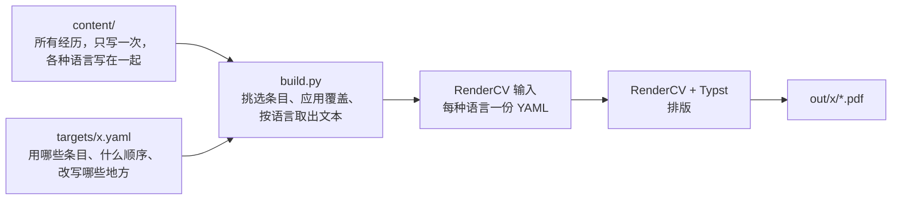
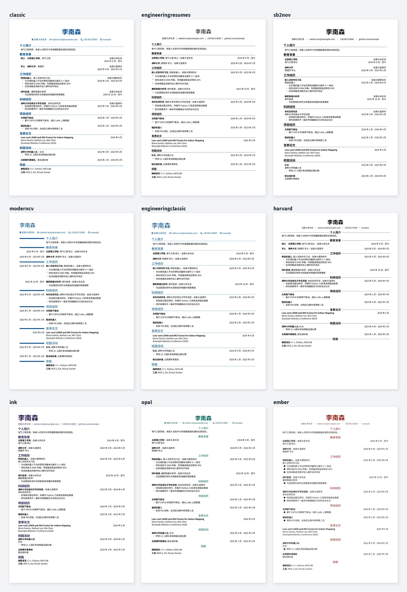

<!-- markdownlint-disable MD033 MD041 -->

<div align="center">

<h1>Prism CV</h1>

<p><strong>一份内容，生成所有简历。</strong></p>

<p>
  <a href="LICENSE"></a>
  
  <a href="https://github.com/rendercv/rendercv"></a>
  <a href="README.md"></a>
</p>

</div>

把所有经历集中放在一处，由它生成每个版本的简历：各种语言、学术版和工业版，以及为每个岗位定制的版本。

## 为什么

简历一旦有了中英两版、学术版和工业版，再加上几份针对具体岗位的定制版，同一段经历就会散落在很多文件里。改一条描述，就得把每一份都找出来同步，时间一长总会对不上。

Prism CV 让每一段内容只存在一处。一个版本的简历只是一份很短的清单，写明要放哪些内容。修改一段经历后重新生成，所有版本都会同步更新。

## 原理



[RenderCV](https://github.com/rendercv/rendercv) 能把一份 YAML 排版成精美的 PDF，但一份简历只能读一个文件，文件里的内容也无法拆分或复用。Prism CV 是它前面很薄的一层：`build.py` 根据内容和版本文件拼出这份 YAML，再交给 RenderCV。排版和字体全部由 RenderCV 负责。

## 快速开始

需要 Python 3.12 或以上。

```sh
pip install -r requirements.txt
python build.py --all
```

PDF 生成在 `out/<版本>/` 下。仓库自带一份虚构的示例简历，可以直接看到效果；把 `content/` 里的文件换成你自己的内容即可。

中文示例使用 [Noto Sans SC](https://fonts.google.com/noto/specimen/Noto+Sans+SC)（思源黑体）。安装下载包里 `static/` 文件夹中的字体，不要装可变字体，Typst 对它支持不完整。

```sh
python build.py industry                               # 生成一个版本
python build.py jobs/2026-10-15_example-data-engineer  # 子文件夹里的版本
python build.py industry --lang en                     # 只生成一种语言
python build.py industry --debug                       # 保留 RenderCV 的输入文件，排查用
```

## 主题

示例简历在 RenderCV 各个内置主题下的效果。在 `design.yaml` 中修改 `theme` 即可切换。



`design.yaml` 中的中文设置是按 `classic` 调好的，换成其他主题时可能需要调整条目模板。

## 目录

```text
content/
  header.yaml     姓名与联系方式
  sections.yaml   板块标题
  *.yaml          条目，可以按任意方式分文件
targets/          每个版本一个文件
  jobs/           针对岗位定制的版本，命名为 日期_公司_岗位.yaml
design.yaml       语言、主题、字体和日期格式
```

## 写内容

每个条目有一个在 `content/` 中唯一的 id，字段名沿用 RenderCV 的字段名（见 [RenderCV 文档](https://docs.rendercv.com)）。

各语言相同的文字只写一次；不同的文字写成“语言代码 → 文字”的映射：

```yaml
brightwave-intern:
  company: { en: Brightwave Robotics, zh: 明波机器人 }
  position: { en: Embedded Software Intern, zh: 嵌入式软件实习生 }
  location: { en: "Montreal, Canada", zh: 蒙特利尔 }
  start_date: 2025-05
  end_date: present
  highlights:
    - en: Wrote C++ drivers for an IMU
      zh: 编写惯性测量单元的 C++ 驱动
```

- 含逗号的文字要加引号，例如 `"Montreal, Canada"`。
- 某条 bullet 在某种语言里不需要，写 `zh: null`。
- 各语言需要的 bullet 条数不同时，写成 `highlights: { en: [...], zh: [...] }`。
- 一个 id 可以对应一组条目，比如一组技能。
- 只有 `text` 字段的条目是一段文字，用于个人简介。

## 写版本

```yaml
langs: [en, zh]
max_pages: 1
sections:
  profile: [profile-industry]
  education: [meng, bsc]
  work: [brightwave-intern, greenleaf-analyst]
```

板块按书写顺序输出，每个 key 都要在 `content/sections.yaml` 里有标题。`langs` 默认是所有已配置的语言；不写 `max_pages` 表示不限页数。

## 定制

```yaml
sections:
  profile:
    - text: 只为这个岗位写的一段简介。
  work:
    title: Experience
    entries:
      - brightwave-intern@data
      - greenleaf-analyst:
          highlights:
            - 为这个岗位改写的一条 bullet
```

- **直接写条目**：在版本文件里直接写一个完整条目。
- **覆盖**：`id: {字段}` 替换这些字段，其余沿用原文。
- **变体**：在 `content/` 中写 `brightwave-intern@data` 这样的 id，会继承 `brightwave-intern` 的所有字段，只替换它写出的字段（用 `base: <id>` 可以指定别的父条目）。
- **标题**：`title:` 只为这个版本改板块标题。

只用一次的改写放在版本文件里；会重复使用的改写做成变体。日期或机构变了，就是另一段经历，应该新建条目，而不是用变体。

## 语言

示例配置了英文和中文，但可以使用任何语言。添加一种语言：

1. 在 `design.yaml` 的 `languages` 中加入它的代码。
2. 在 `design.yaml` 里，凡是已有语言写了值的地方，都为新语言补上：字体、日期格式、条目模板，以及 `locale.language`（RenderCV 支持的语言之一）。
3. 为用到这种语言的版本所引用的内容补上译文。缺了哪些字段，构建时会逐一指出。

列表中的第一种语言决定 PDF 的文件名。

## 检查

遇到以下情况，`build.py` 会停下并指出文件和位置：id 重复或不存在、某种语言缺少文本、同一板块混入不同类型的条目、板块没有标题、`max_pages` 不是正整数。PDF 超过 `max_pages` 时会给出警告。日期和字段格式由 RenderCV 校验。

## 注意

- RenderCV 的版本固定在 `requirements.txt` 中，它的 YAML 格式在大版本之间有过变化。
- bullet 里不要写 ` - `，RenderCV 会把它当成子列表。
- 版本文件引用的是内容，修改 `content/` 后重新生成会得到新的文字。投递出去的 PDF 请自行保存。

## 许可证

```text
MIT License

Copyright (c) 2026 Andy Zhang

Permission is hereby granted, free of charge, to any person obtaining a copy
of this software and associated documentation files (the "Software"), to deal
in the Software without restriction, including without limitation the rights
to use, copy, modify, merge, publish, distribute, sublicense, and/or sell
copies of the Software, and to permit persons to whom the Software is
furnished to do so, subject to the following conditions:

The above copyright notice and this permission notice shall be included in all
copies or substantial portions of the Software.

THE SOFTWARE IS PROVIDED "AS IS", WITHOUT WARRANTY OF ANY KIND, EXPRESS OR
IMPLIED, INCLUDING BUT NOT LIMITED TO THE WARRANTIES OF MERCHANTABILITY,
FITNESS FOR A PARTICULAR PURPOSE AND NONINFRINGEMENT. IN NO EVENT SHALL THE
AUTHORS OR COPYRIGHT HOLDERS BE LIABLE FOR ANY CLAIM, DAMAGES OR OTHER
LIABILITY, WHETHER IN AN ACTION OF CONTRACT, TORT OR OTHERWISE, ARISING FROM,
OUT OF OR IN CONNECTION WITH THE SOFTWARE OR THE USE OR OTHER DEALINGS IN THE
SOFTWARE.
```
