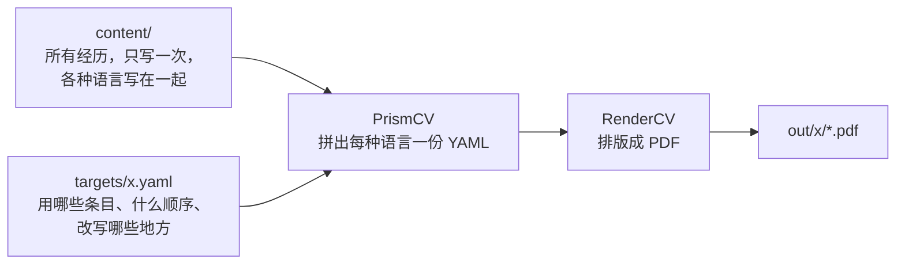

<!-- markdownlint-disable MD033 MD041 -->

<div align="center">

<h1>Prism CV</h1>

<p><strong>一份内容，生成所有简历。</strong></p>

<p>
  <a href="https://github.com/AnzhiZhang/PrismCV/blob/main/LICENSE"></a>
  
  <a href="https://pypi.org/project/prismcv/"></a>
  <a href="https://github.com/rendercv/rendercv"></a>
  <a href="https://github.com/AnzhiZhang/PrismCV/blob/main/README.md"></a>
</p>

</div>

把所有经历集中放在一处，由它生成每个版本的简历：各种语言、学术版和工业版，以及为每个岗位定制的版本。一段经历只改一次，所有版本都会更新。

## 原理



[RenderCV](https://github.com/rendercv/rendercv) 把一份 YAML 排版成 PDF。Prism CV 根据内容和版本文件拼出这份 YAML，排版全部由 RenderCV 完成。

## 快速开始

需要 Python 3.12 以上。

```sh
pip install prismcv
prismcv init my-cv                  # 用最小模板新建一个简历文件夹
cd my-cv
prismcv build --all                 # 所有版本
prismcv build main --lang en        # 一个版本、一种语言
prismcv build main --debug          # 保留生成的 RenderCV 输入文件
```

简历文件夹包含 `cv.yaml`、`design.yaml`、`content/` 和 `targets/`。在其中运行 `prismcv build`，或者用 `--root` 指定这样的文件夹。PDF 输出到 `out/<版本>/`，输入没有变化的 PDF 不会重新渲染（`--force` 强制渲染）。

`prismcv init --example` 会改为生成一份完整的中英双语示例，用到下面介绍的所有功能。`--example-rendercv` 则生成用同样方式写成的 [RenderCV 官方样例](https://github.com/rendercv/rendercv)。

## 主题

在 `design.yaml` 中修改 `theme`。


## 内容

`cv.yaml` 是姓名、联系方式和板块标题。`content/` 里的每个文件按 id 存放条目，怎么分文件由你决定。字段名沿用 [RenderCV 的字段](https://docs.rendercv.com)。

各语言不同的文字写成“语言代码 → 文字”，其余只写一次。下面节选自示例的 [`content/experience.yaml`](https://github.com/AnzhiZhang/PrismCV/blob/main/src/prismcv/example/content/experience.yaml)：

```yaml
brightwave-intern:
  company: { en: Brightwave Robotics, zh: 明波机器人 }
  location: { en: "Montreal, Canada", zh: 蒙特利尔 }
  start_date: 2025-05
  end_date: present
  highlights:
    - en: Wrote C++ drivers for an IMU
      zh: 编写惯性测量单元的 C++ 驱动
```

某条 bullet 在某种语言中不需要，写 `zh: null`。一个 id 也可以对应一组条目（比如一组技能），只有 `text` 的条目是一段文字（比如个人简介）。

## 版本

`targets/` 里每个文件是一个版本的简历。`langs` 默认生成所有语言，`max_pages` 在 PDF 超出页数时给出警告。`targets/archive/` 中的版本（例如已投递的岗位）不参与 `--all`。下面节选自示例中[一个针对岗位定制的版本](https://github.com/AnzhiZhang/PrismCV/blob/main/src/prismcv/example/targets/jobs/2026-10-15_example-data-engineer.yaml)：

```yaml
langs: [en]
max_pages: 1
sections:
  profile:
    - text: Engineer who enjoys turning messy sensor data into reliable pipelines.
  work:
    title: Experience
    entries:
      - brightwave-intern@data
      - greenleaf-analyst:
          highlights:
            - Rewritten bullet for this role only
```

条目可以是一个 id、带覆盖字段的 id，或者直接写出的条目。`brightwave-intern@data` 这样的变体写在 `content/` 中，只改写它列出的字段，适合会重复使用的改写。`title` 为这个版本修改板块标题。

### 隐藏 bullet

为 bullet 加上 `id`，然后在版本条目的 `hide` 中列出要隐藏的 id：

```yaml
# content/experience.yaml
brightwave-intern:
  company: Brightwave Robotics
  position: Intern
  highlights:
    - id: drivers
      en: Wrote C++ drivers for an IMU
      zh: 编写惯性测量单元的 C++ 驱动
    - id: shared
      text: Improved reliability
    - en: Cut sensor read latency by 30%
      zh: 传感器读取延迟降低 30%

# targets/industry.yaml
sections:
  work:
    - brightwave-intern: { hide: [drivers], position: Engineer }
```

id 是可选的，原有写法继续有效。`text` 可以是各语言共用的文字，也可以是语言映射。只有 `hide` 列出的 bullet 会被隐藏，新 bullet 默认保留；修改文字或调整顺序不影响隐藏选择。

隐藏在变体继承和字段覆盖之后生效。id 必须是非空字符串，在同一条目中不能重复；指定的 id 若不在最终 `highlights` 中，构建会报错。

## 语言

`design.yaml` 中的 `languages` 把每个语言代码对应到一个 [RenderCV 语言](https://docs.rendercv.com)。添加语言时，在这里加上它，把它需要的设置（字体、日期格式）写在它的代码下，再为用到的内容补上译文；缺少的地方构建时会列出来。

## 在 Python 中使用

命令行只是一层外壳，核心功能都是处理普通字典的函数，因此其他程序也可以用不在文件里的数据生成简历：

```python
from prismcv import CV, validate

cv = CV(cv_yaml, design_yaml, entries)       # 与简历文件夹相同的数据，以字典形式传入
result = cv.assemble(target, "en")           # 一个版本、一种语言的 RenderCV 输入
for issue in validate(result):               # RenderCV 自身的校验
    print(issue.source, issue.message)       # 每个问题都指向它所在的条目和字段
```

## 开发

```sh
pip install -e . --group dev
pytest
```

`tests/golden/example.json` 保存了示例简历生成的 RenderCV 输入，它一旦变化测试就会失败。有意修改之后，用 `python tests/test_golden.py` 重新生成。

## 许可证

```text
MIT License

Copyright (c) 2026 Andy Zhang

Permission is hereby granted, free of charge, to any person obtaining a copy
of this software and associated documentation files (the "Software"), to deal
in the Software without restriction, including without limitation the rights
to use, copy, modify, merge, publish, distribute, sublicense, and/or sell
copies of the Software, and to permit persons to whom the Software is
furnished to do so, subject to the following conditions:

The above copyright notice and this permission notice shall be included in all
copies or substantial portions of the Software.

THE SOFTWARE IS PROVIDED "AS IS", WITHOUT WARRANTY OF ANY KIND, EXPRESS OR
IMPLIED, INCLUDING BUT NOT LIMITED TO THE WARRANTIES OF MERCHANTABILITY,
FITNESS FOR A PARTICULAR PURPOSE AND NONINFRINGEMENT. IN NO EVENT SHALL THE
AUTHORS OR COPYRIGHT HOLDERS BE LIABLE FOR ANY CLAIM, DAMAGES OR OTHER
LIABILITY, WHETHER IN AN ACTION OF CONTRACT, TORT OR OTHERWISE, ARISING FROM,
OUT OF OR IN CONNECTION WITH THE SOFTWARE OR THE USE OR OTHER DEALINGS IN THE
SOFTWARE.
```
